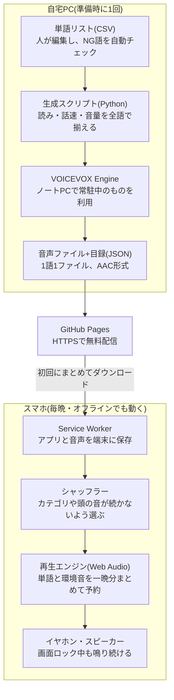
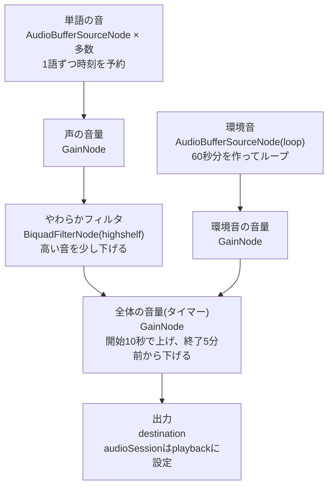

# シャッフル睡眠アプリ 設計書

2026-10-27 時点

## 1. 概要

画面を消したスマホから、脈絡のない単語を自然な声でランダムに読み上げ続け、環境音と一緒に寝つきを助けるブラウザアプリ(PWA)を作る。仮称は「ねむシャッフル」。

シャッフル睡眠法(認知シャッフル)は、カナダの認知科学者リュック・ボードワン(Luc P. Beaudoin)が提唱した入眠法。互いに無関係な単語を次々に思い浮かべて情景をぼんやりイメージし、悩みや考えごとの連鎖を断ち切る。眠りに落ちる直前の「とりとめのない思考」に近い状態を意図的に作る、という考え方に基づく。

このアプリのゴールは次の4つ。

- 布団に入って1タップで開始し、あとは画面を消して目を閉じるだけで済む
- 単語が尽きず、毎回違う順番で、聞き疲れしない声で流れる
- タイマーで自然にフェードアウトして止まる
- 声・単語・環境音はすべて、出どころと利用条件がはっきりした素材だけを使う

## 2. 要件

必須はご要望の5点。加えて「布団の中で、画面を消して、半分寝ながら使う」前提から、次の非機能要件を置く。

| 区分 | 要件 | 由来・理由 |
| --- | --- | --- |
| 必須 | 単語をエンドレスかつランダムに読み上げる | ご要望 |
| 必須 | タイマーで自動停止する | ご要望 |
| 必須 | 自然な発声 | ご要望 |
| 必須 | 環境音BGMを流せる | ご要望 |
| 必須 | スマホのブラウザで動く(iPhoneを最優先、Androidは動く範囲で) | ご要望 |
| 非機能 | 画面を消しても、消音スイッチがONでも鳴り続ける | 画面の光を浴びないため。寝る時はマナーモードにしがちなため |
| 非機能 | 1タップで前回の設定のまま開始できる | 眠い状態で細かい操作をさせないため |
| 非機能 | 通信なしで動く(オフライン) | 寝室の電波状況や機内モードに左右されないため |
| 非機能 | 止まる時に音がいきなり切れない | 急な無音で目が覚めるのを防ぐため |
| 非機能 | 声・単語・環境音はすべて利用条件を確認済みのものだけ | 合法性が怪しい素材は使わない方針のため |
| 対象外 | 睡眠の計測・記録、アカウント、課金 | 寝つきを助けるという目的に直結しないため |

## 3. 全体構成

音声は自宅PCで一度だけ作ってGitHub Pagesに置き、スマホは毎晩それを再生するだけの2層構成にする。



重い処理(音声合成と整音)をすべて自宅PC側に寄せることで、スマホ側は通信なしで動き、寝る前の操作も1タップで済む。再生エンジンが、画面ロック中の安定性を左右する中心部分(8章)。

## 4. 主要な設計判断と採用理由

いちばん大きな判断は「声をその場で合成せず、自宅PCのVOICEVOXで全単語を事前に録っておく」こと。自然な声・オフライン・画面オフ再生の3つを同時に満たせるのは、この方式だけだった。

### D1 アプリ形式: PWA(ホーム画面に追加できるWebアプリ)

- **採用**: PWA
- **不採用**: ネイティブiOSアプリ(ビルドにMacが必要で、今はまだ作れない)、普通のWebページ(オフラインで動かず、毎回Safariのタブを探す手間がある)
- **理由**: ご要望どおりブラウザアプリのまま、ホーム画面から全画面で起動でき、Service Workerでオフライン動作もできる。

### D2 声: VOICEVOXで全単語を事前生成して同梱

- **採用**: 単語ごとの音声ファイルを自宅PCで作り、アプリに入れて配る
- **不採用1: ブラウザ内蔵の読み上げ(Web Speech API)**。声の質が端末とOSの音声データ次第で揃わない。出力をWeb Audioに通せないため、フェードや環境音との合成を正確に制御できない。
- **不採用2: クラウドの音声合成をその都度呼ぶ**。通信が必須でオフラインにならない。APIキーを静的サイトに置くと漏れる。読み上げのたびに費用と遅延がかかる。
- **理由**: 生成は一度で済み、声質・読み・音量を事前に全部確認して揃えられる。ノートPCで既に動いているVOICEVOXをそのまま使えるので追加費用ゼロ。再生側は「短いファイルを鳴らすだけ」になり、画面オフでも安定する。
- **代償**: 単語を増やすたびに再生成が必要(スクリプトで自動化する)。話す速さは生成時に決める。再生時に速度を変えると声の高さまで変わり、不自然になるため。

### D3 再生方式: Web Audio APIで、一晩分を開始時に予約する

- **採用**: 開始ボタンを押した瞬間に、タイマー終了までの全単語・環境音・フェードアウトを、音声処理側にまとめて予約する
- **不採用**: 1語ずつJavaScriptのタイマーで鳴らす方式、`<audio>` 要素で1ファイルずつ順に鳴らす方式
- **理由**: iPhoneでは画面ロック中にJavaScriptの実行が止まり、裏から新たに再生を始めても音が出ない事例が長く報告されている([WebKitバグ173332](https://bugs.webkit.org/show_bug.cgi?id=173332))。`<audio>` の再生が自然に終わるとiOSが音声セッションを閉じ、ロック中は再開できないという報告も2026年10月に出ている([daily.dev](https://daily.dev/posts/getting-my-iphone-music-app-to-keep-playing-on-the-lock-screen-l8ytobjbj))。先に全部予約しておけば、ロック後にJavaScriptが一切動かなくても最後まで鳴り、予定どおりフェードして止まる。
- **補足**: iOS 16.4以降のSafariは `navigator.audioSession` に対応している([web-features](https://web-platform-dx.github.io/web-features-explorer/features/audio-session))。これを `"playback"` にしてもバックグラウンドでAudioContextが止まる不具合は修正済みとされ、iOS 17.5以降が目安([再検証の記録](https://github.com/fischnall3r/sadiss/issues/134))。playbackはネイティブiOSでは消音中・ロック中も鳴り続ける区分なので([JW Player資料](https://docs.jwplayer.com/players/docs/ios-player-backgrounding-reference))、消音スイッチ対策も兼ねる。実機での確認はフェーズ0で行う。

### D4 環境音: まずはプログラムで合成する

- **採用(初期)**: ブラウンノイズ、ピンクノイズ、雨、波をWeb Audio上で合成
- **不採用(初期)**: ネット上の環境音素材や録音
- **理由**: ライセンス確認が要らず、容量はほぼゼロ、ループの継ぎ目もない。録音素材は本物らしさで勝るが、素材ごとに利用条件が違い、継ぎ目も気になりやすい。焚き火や虫の声など合成が難しい音は、利用条件が明確な素材だけを後から足す。

### D5 単語リスト: 自作する

- **採用**: ゼロから作る単語リスト(CSV)。たたき台はClaudeが出し、1語ずつ人が選ぶ
- **不採用**: 既存のシャッフル睡眠アプリや書籍の単語リストの流用
- **理由**: 他人のリストの丸写しは著作権や規約上の問題になりうる。自作なら「眠りを妨げない語」という基準で選べる。

### D6 シャッフル: 制約つきランダム

- **採用**: ランダムに引きつつ、同じカテゴリや同じ頭の音が続かないようにずらす
- **理由**: 「りんご→みかん→ぶどう」のように連想がつながると、考えに筋道ができてしまう。認知シャッフルの狙いである「脈絡のなさ」が弱まる。

### D7 タイマー: フェードも開始時に予約する

- **採用**: 終了数分前から音量を下げる指示を、開始時に音量パラメータの自動変化として予約
- **理由**: JavaScriptが止まっていても時刻どおり実行される。急に無音にならない。

### D8 配信: GitHub Pages

- **採用**: 公開リポジトリ + GitHub Pages(無料)
- **不採用**: 自宅ノートPCのCaddyから配信
- **理由**: Service WorkerとPWAにはHTTPSが必須で、GitHub Pagesなら設定ほぼなしで満たせる。GitHubアカウントも既にある。自宅配信は証明書の手間と、PCが止まっていると更新できない弱点がある。
- **注意**: 無料プランのGitHub Pagesは公開リポジトリが前提で、サイトも誰でも見られる。公開されるのはコードと単語の音声だけで、設定や履歴は端末内にしか保存しない。声のクレジット表記を必ず入れる(10章)。

### D9 技術スタック: Vite + TypeScript、UIフレームワークなし

- **理由**: 画面は3〜4枚と小さく、Reactなどを入れてもJSが重くなるだけ。依存を減らすほど、Claude Codeでの保守が楽になり、長く安定して動く。PWA化はvite-plugin-pwaで定型的に済む。

## 5. 機能仕様

画面は4枚(フェーズ2で1枚追加)。普段触るのはホームの開始ボタン1つだけで済むようにする。

### 画面

1. **ホーム**: 画面中央に大きな開始ボタン。下に前回の設定(タイマー・環境音・声)をチップで並べ、タップで切り替える。アプリを開いた時点で音声の準備を始め、終わるまでボタンに「準備中」と出す。
2. **再生中**: ほぼ真っ黒の画面に、残り時間と停止・一時停止ボタンだけを暗い暖色で表示。5秒触らないとさらに暗くなる。単語は画面に出さない。文字を読むと目が冴えるうえ、画面を見ないことが前提のため。
3. **設定**: 下表の項目。保存は端末内(localStorage)。
4. **このアプリについて**: 声のクレジット、環境音の出どころ、注意書き。
5. **昨夜の単語(フェーズ2)**: 朝に開くと昨夜流れた単語が見られ、「気になった語」を除外できる。

ロック画面の再生・停止ボタン(Media Session API)は、iOSでWeb Audioだけの再生でも表示されるかが未確認のため、フェーズ0で確かめてから入れる。

### 設定項目と既定値

既定値は試しながら調整する前提の初期値。

| 項目 | 既定値 | 選べる範囲 | 理由 |
| --- | --- | --- | --- |
| タイマー | 30分 | 15/30/45/60/90分、エンドレス | 寝つくまでをカバーし、眠った後は長く鳴らさない |
| エンドレスの上限 | 8時間 | 固定 | 電池を守るため。ロック中は延長処理が動かないので、上限までを先に予約する |
| フェードアウト | 最後の5分 | 1〜10分 | 急な無音で目が覚めないように |
| フェードイン | 10秒 | 固定 | ボタンを押した直後に大きな音が出ないように |
| 読み上げ間隔 | 8秒 | 5〜20秒 | 1語の情景を思い浮かべる余裕を作りつつ、空白が長すぎて考えごとが戻らないように |
| 間隔のゆらぎ | ±1秒 | 0〜2秒 | メトロノームのような規則正しさに注意が向くのを防ぐ |
| だんだんゆっくり | オン(終了時に間隔1.5倍) | オン/オフ | 眠くなるほど1語を長く味わえるように |
| 声 | No.7(読み聞かせ)・話速1.0 | 2〜3種 | 声の好みは人によって大きく違うため。試聴して選ぶ(7章「声の選び方」) |
| カテゴリ | 全部オン | カテゴリごとにオン/オフ | 空腹の夜は食べ物を外す、など |
| 環境音 | 雨 | なし/ブラウンノイズ/ピンクノイズ/雨/波 | 声の合間の静けさを埋め、生活音を目立たなくする |
| 声と環境音の音量 | 声80%・環境音20% | それぞれ0〜100% | 声を主役に、環境音は控えめに置く。フェーズ0の実機試験で、環境音40%・32%では声が埋もれた。試作では環境音を10〜32%から選べるようにして、端末で聞きながら決める |
| やわらかフィルタ | オフ | オン/オフ | サ行などの高い音が耳に刺さるのを抑える。試聴で声に引っかかりを感じたため既定はオフにし、改善課題とした(12章) |
| タイマー後も環境音だけ続ける | オフ | オン/オフ(最長8時間) | 環境音がないと眠れない人向け |

## 6. 単語データ仕様

最初は300語、フェーズ2で1500語以上に増やす。採用の基準は「目を閉じた瞬間に絵が浮かび、しかも何も心配ごとを連れてこない語」。

### 選ぶ基準

- 目に見える具体的なもの(名詞)。希望・自由のような抽象語は絵が浮かびにくいので外す
- 穏やか、または中立な語
- 2〜6音くらいの短い語
- 子どもでも分かる身近な語

### 外す語

| 種類 | 例 | 理由 |
| --- | --- | --- |
| 不安・恐怖・痛み | 地震、注射、おばけ | 不安をあおり、目が冴える |
| 仕事・勉強・お金 | 会議、締め切り、試験、財布 | 明日の心配ごとに直結する |
| 人物・人間関係 | 母、上司、友だち | 特定の人を思い出して考えごとが始まる |
| 固有名詞・商品名・地名 | ブランド名、駅名 | 個人的な記憶を呼び起こしやすい。商標の問題も避けられる |
| 刺激が強い | 激辛、雷 | 体が反応してしまう |
| 同音異義語 | はし(橋・箸)、くも(雲・蜘蛛) | 「どっちだろう」と考えてしまう |

### カテゴリ(初期案)

自然の風景、空と天気、植物、陸の生き物、海と川の生き物、食べ物、台所と日用品、道具と文房具、乗り物、建物と場所、楽器とおもちゃ の11種。設定画面でカテゴリごとにオン・オフできる。

### データ形式

人が編集するのはCSVだけ。読みを固定したい語だけ `kana` 列を埋める。

```csv
id,text,kana,category
w0001,りんご,,food
w0002,風車,フウシャ,place
w0003,ふうりん,,kitchen
```

生成スクリプトが、アプリ用の目録(manifest.json)と音声ファイル(`/audio/<声ID>/<単語ID>.m4a`)を出力する。

```json
{
  "version": 1,
  "voices": [{ "id": "a", "credit": "VOICEVOX:(キャラクター名)" }],
  "categories": [{ "id": "food", "label": "食べ物" }],
  "words": [{ "id": "w0001", "text": "りんご", "cat": "food", "dur": 0.82 }]
}
```

### シャッフル規則

1. 有効なカテゴリの語から、一晩分の「デッキ」として最大400語をランダムに抜き出す(上限はメモリのため。8章)
2. デッキから1語ずつ引く。直前2語と同じカテゴリ、直前の語と同じ頭の音、直前の語の最後の音で始まる語(しりとりになる)は後回しにする
3. 条件を満たす語がなければ、条件をゆるめて引く
4. デッキを使い切ったら並べ直して2周目に入る。8秒間隔なら約53分後なので、たいていはもう眠っている
5. 直近3晩に流した語は、デッキに入りにくくする(履歴は端末内に保存)

## 7. 音声生成パイプライン

CSVを直して1コマンド実行すると、全単語の音声ファイルと目録ができる。合成はノートPCで常駐しているVOICEVOX Engineに任せる。

1. **チェック**: CSVの重複・空欄・NG語(外す語の辞書と照合)を自動で検査する
2. **合成**: VOICEVOX EngineのAPI(audio_query → synthesis)で1語ずつWAVにする。話速(既定0.85倍、声ごとに指定できる)、抑揚やや控えめ(0.8)、前後の無音0.1秒を全語共通で指定。kana列がある語は読みを固定して合成する
3. **整音**(ffmpeg): 前後の無音を削る → 両端に10ミリ秒のフェードを付ける(再生時の「プツッ」を防ぐ) → 平均音量(RMS)を全語で揃える。1秒前後の短い音はピーク基準では体感音量が揃わないため
4. **変換**: AAC(.m4a)・モノラル・24kHz。iPhoneのSafariとAndroidのChromeのどちらでも確実に再生でき、1語あたり数KBで済む。1500語でも1声10MB前後が目安
5. **試聴**: 全語をカテゴリ順に連続再生できるローカルの試聴ページを作り、読み間違いやアクセントの不自然な語を探す → kana列で直して再生成
6. **目録の出力**: manifest.jsonに語ごとの長さとファイルのハッシュを書く。単語を足したとき、変わったファイルだけが端末に再配信される

話速を遅めにするのは、速い語りほど注意を引きやすく、眠りの邪魔になりやすいと考えたため。最適値は実際に聞いて決める。フェーズ0で採用したNo.7(読み聞かせ)は、もともとゆっくりした話し方のスタイルで、0.85倍では遅すぎたため1.0倍にした。

VOICEVOX Engineは標準では同じPCからの接続しか受け付けない設定のはずなので、生成スクリプトはノートPC上で実行するのが簡単。別PCから使う場合はエンジンをLANに開放する設定が必要。

### 声の選び方

VOICEVOXのキャラクターから、落ち着いた・ささやき・しっとり系のスタイルを持つものを3つほど候補にする。同じ20語で聞き比べ、2つに絞る。利用規約はキャラクターごとに違うため、候補ごとに必ず規約を確認する(10章)。

聞き比べは、候補を公開しないフォルダ(`audition/`)に作り、開発用の試聴ページ(`/audition.html`)で行う。

フェーズ0(2026-10-28)の聞き比べの結果:

- ささやき系(四国めたん・ずんだもん・九州そらの「ささやき」、青山龍星の「囁き」)は、どれも違和感があり不採用
- 普通の話し方の18種から、No.7(読み聞かせ)ともち子さん(のんびり)を話速0.85倍と1.0倍で比べ、**No.7(読み聞かせ)・話速1.0倍**を採用した。クレジットは「VOICEVOX:No.7」

## 8. 再生エンジン詳細

開始ボタンを押した時点で、終了までに鳴る音をすべて音声処理側に予約し、その後はJavaScriptに頼らない。



単語の声だけに「やわらかフィルタ」をかけ、最後の「全体の音量」でタイマーのフェードをまとめてかける。こうすると、声と環境音のバランスを崩さずに一緒に小さくできる。

### 開始時の処理(タップ後1秒以内に終える)

1. AudioContextを24kHzで作り、対応端末では `navigator.audioSession.type = "playback"` を設定する
2. 終了時刻までの全単語の再生時刻を計算する。間隔は「基本間隔 ×(1 + 0.5 × 経過の割合)± ゆらぎ」
3. 単語ごとに再生ノードを作り、計算した時刻で `start(時刻)` を予約する。8秒間隔なら60分で約450個、エンドレス(8時間)で約3600個
4. 環境音ループを始め、終了時刻に `stop(時刻)` を予約する
5. 全体の音量に、フェードイン(10秒)と終了前のフェードアウトを自動変化として予約する

### 重い準備は「アプリを開いた時」に済ませる

音声ファイル400語分の展開(デコード)には数秒かかる。タップ後に始めると、すぐ画面をロックされた時に予約が終わらないおそれがある。そこで、アプリを開いて設定を見ている間に展開を済ませ、終わるまで開始ボタンに「準備中」と出す。

### 一時停止と停止

- **一時停止**: AudioContextを止める(suspend)。予約はAudioContextの時計に乗っているので、時計も止まる
- **再開**: AudioContextを作り直し、止まった位置から終了までを予約し直す(読み上げ途中の語は続きから、音量は1.5秒かけて戻す)。単語の順番と時刻は開始時に決めた予定を使うので、作り直しても変わらない。止めたAudioContextをそのまま再開(resume)すると、iPhoneでは「動いている」状態なのに時計が進まず無音になることがあったため(12章「フェーズ0の実機試験」)。再開後2.5秒たっても時計が進まなければ、一時停止の状態に戻して記録に残す
- **外からの一時停止**: ロック画面の一時停止ボタンや着信では、アプリの処理を通さずブラウザが直接AudioContextを止める。アプリが止めていないのに止まったら一時停止と同じに扱い、止まっていた時間は「ずれ」に数えず別に記録する
- **停止ボタン**: 全体の音量を1秒で下げてから閉じる。「ブツッ」と切らない
- **タイマー終了後**: 音は予約どおり止まっている。AudioContextを閉じる後片付けは、JavaScriptが動ける時(遅くとも朝にアプリを開いた時)に行う

### メモリの目安

展開後の音声は無圧縮で、24kHzなら1秒あたり約96KB。400語×約1秒で約40MBになる。既定の48kHzで作ると倍になるため、生成時と同じ24kHzでAudioContextを作る。iPhoneでこの指定が効くかもフェーズ0で確かめる。

## 9. 環境音BGMの仕様

下の4種はすべてプログラムで合成し、素材ファイルは使わない(フェーズ1はブラウンノイズと雨の2種から)。開始時に60秒分の音を作ってループさせるので、ロック中にJavaScriptが止まっても鳴り続ける。

| 環境音 | 作り方 | 聞こえ方 |
| --- | --- | --- |
| ブラウンノイズ | ホワイトノイズを積み重ねて、低い音ほど強くする | 遠くの滝や低い風。いちばん耳当たりが柔らかい |
| ピンクノイズ | ホワイトノイズの高い音を控えめにする | ザーッという均一な音 |
| 雨 | ノイズを雨音らしい帯域に絞り、ランダムな雨粒の音を重ねる | 窓の外の雨 |
| 波 | ノイズの音量とこもり具合を、10秒前後の周期でゆっくり上下させる | 寄せては返す波 |

- 60秒分は開始時に OfflineAudioContext で書き出す。雨粒の位置などはその都度ランダムに決まるので、毎晩少しずつ違う音になる
- ループのつなぎ目は前後を重ねて(クロスフェード)聞こえないようにする。波の周期は60秒で割り切れる値を組み合わせ、つなぎ目で波のリズムが乱れないようにする
- 声の音量とは別に調整でき、タイマー終了時は声と一緒にフェードアウトする
- 焚き火・虫の声・川など合成が難しい音は、フェーズ3で利用条件が明確な録音素材を足す。その際は素材ごとに出どころとライセンスを台帳に記録する

## 10. 合法性・ライセンスの確認事項

結論として、この設計で使う素材はすべて公式に認められた範囲に収まる。ただしVOICEVOXのクレジット表記は必須で、忘れると規約違反になる。

| 対象 | 判定 | 根拠と対応 |
| --- | --- | --- |
| VOICEVOXで作った声をアプリに入れて公開する | 使える(クレジット必須) | 例えばずんだもん・四国めたん等の規約は、商用・非商用とも利用可で「VOICEVOX:キャラクター名」の表記が必須。アプリなら紹介画面など少し探せば分かる場所に書く([規約](https://zunko.jp/con_ongen_kiyaku.html))。→「このアプリについて」画面に表記する |
| キャラクターごとの規約の違い | 要確認 | 規約はキャラクターごとに異なり、企業が関わる利用に事前確認を求めるキャラクターもいる([VOICEVOX Engine](https://hub.docker.com/r/voicevox/voicevox_engine))。→ 声を決めたら、そのキャラクターの規約を全文読んでから採用する |
| 採用した声 No.7 | 使える(非商用・クレジット必須) | 個人が作った音声は「VOICEVOX:No.7」と書けば非商用で使える(同人利用や配信の収入は可)。それ以外の商用利用は「No.7製作委員会」への事前確認が必要([規約](https://voiceseven.com/)、2026-10-28確認)。→ 無料・広告なしの個人アプリなので当てはまる。「このアプリについて」に表記済み。有料化・広告・企業との提携などをするときは先に製作委員会に確認する |
| 声の禁止用途 | 該当しない | 上記の共通規約は政治・宗教活動、情報商材、虚偽情報などでの利用を禁じている。個人の睡眠用アプリは当たらない |
| 非公式の音声モデル(有名人・声優の声を真似たAIモデルなど) | 使わない | 本人や権利者の許諾がない声は、パブリシティ権や配布元の規約に触れうる。公式配布の音声ライブラリだけを使う |
| 他のアプリや書籍の単語リスト | 使わない | 丸写しは著作権や利用規約に触れうる。自作する(D5) |
| ネットの環境音や動画から切り出した音 | 使わない | 録音物には著作権や著作隣接権がある。初期は合成音だけ。後で素材を足す時は利用条件を確認し、出どころを記録する |
| 「mySleepButton」の名前 | 使わない | 提唱者側のアプリ名で、登録商標(®)として表記されている([App Storeの説明](https://apps.apple.com/app/id740251957))。手法そのものを使うのは問題ないが、名前やロゴは借りない |
| 効果・効能の書き方 | 注意 | 公開サイトになるため、「不眠が治る」など治療効果をうたう文言は書かない。病気の治療を目的とするソフトは、医療機器プログラムとして規制の対象になりうるため |

仮称の「ねむシャッフル」は、検索した範囲では同名のアプリが見当たらなかった。公開前に、特許庁のJ-PlatPatで同じ・似た名前の商標がないかも確認する。

## 11. リスクと実機検証項目

最大のリスクは「iPhoneの画面ロック中に音が止まる」こと。本格的に作り始める前に、フェーズ0の小さな試作を実機で30分鳴らして確かめる。

| リスク | 起きると | 対策・確認方法 |
| --- | --- | --- |
| 画面ロック中にAudioContextが止まる | 数分で無音になる | audioSessionをplaybackに設定。iOSのバージョンを記録し、ロック+消音スイッチONで30分鳴るか確認する。だめなら、Web Audioの出力を `<audio>` 要素経由で流す方式を試す |
| ロック中にJavaScriptが止まる | 単語の補充や終了処理が動かない | 一晩分を開始時に予約する(D3)。停止後の後片付けは、朝アプリを開いた時に行う |
| 環境音「なし」で無音が続き、iOSが再生終了とみなす | 単語の合間に止まる | 試作で確認する。止まるなら、聞こえないほど小さなノイズを常に流す |
| 着信・アラーム・他アプリの音で中断される | 再生が止まり、ロック中は再開できない | 再開はしない前提にする。朝に「途中で中断されました」と表示する。アプリを開いて「再開」を押せば、AudioContextを作り直して続きから鳴らす(8章) |
| メモリ不足でページが落ちる | 再生が止まる | AudioContextを24kHzで作り、デッキを400語に制限する(1語1秒なら約40MB) |
| 読み間違い・不自然なアクセント | 気になって目が覚める | 試聴ページで全語チェックする(7章) |
| 単語で嫌な連想をする | 逆効果になる | 外す語のルール(6章)と、昨夜の単語画面からの除外(フェーズ2) |
| Androidの省電力機能で止まる | 途中で無音になる | メーカーによる差が大きいので、手元のAndroid端末で動作確認できた範囲だけ対応とする |

iPhoneでの確認は、試作の段階からGitHub Pagesに上げてHTTPSで開く。ロック中の再生まわりの機能は、HTTPSのページでないと正しく試せない可能性があるため。

## 12. 開発フェーズ

いちばん不確かな「ロック中も鳴り続けるか」を最初に潰し、そのあと最小版を1週間使ってから広げる。開発はClaude Codeで進め、GitHubで管理する。

| フェーズ | 内容 | 完了の目安 |
| --- | --- | --- |
| 0 技術検証 | 単語10語+ブラウンノイズだけの試作。iPhone実機で、画面ロック・消音スイッチONのまま30分鳴らす。ロック画面の操作ボタンが出るかも見る | 30分途切れずに鳴り、予約したフェードで止まる |
| 1 最小版 | 300語、声1種、ブラウンノイズと雨、タイマー15/30/60分、フェード、PWA化、GitHub Pagesで公開 | 自分が1週間、毎晩使える |
| 2 使い込み | 1500語、声2〜3種、全設定項目、ピンクノイズと波、昨夜の単語画面 | 気になる語や操作の不満が出なくなる |
| 3 拡張(任意) | 録音系の環境音(利用条件確認済みのもの)、Androidでの動作確認 | 必要になったら着手 |

### フェーズ0の実機試験

iPhone(iOS 18.7、Chrome から「ホーム画面に追加」して起動、HTTPS)での結果。

| 日付 | 試したこと | 結果 |
| --- | --- | --- |
| 2026-10-28 | 3分・ブラウンノイズ・ロック | 24kHz で動き、audioSession は playback。ロックしたまま終了まで進み、タイマーで止まった。ロック画面に操作ボタンが出た |
| 2026-10-28 | ロック画面の一時停止 → 数秒後に再生 | アプリの Media Session の処理は呼ばれず、ブラウザが AudioContext を直接止めて・再開した。止めた時間が「ずれ」に数えられていたので、「外からの一時停止」として分けた |
| 2026-10-29 | ロック画面の一時停止 → 約50秒後に再生・アプリで再開 | ロック画面の再生ボタンでは戻らなかった(押した記録もなく、止まっている間はページごと休まされているとみられる)。アプリで再開すると「running」になったが時計が進まず無音だった。再開時に AudioContext を作り直すように変えた |
| — | 30分・ロック・消音スイッチ ON・操作なし | 未実施 |

### 改善課題

| 課題 | 状況 | 次に試すこと |
| --- | --- | --- |
| ロック画面で一時停止すると、ロック画面の再生ボタンでは戻らないことがある | 2026-10-29 に判明。アプリを開いて「再開」すれば戻る | 出力方式「audio要素経由」なら、ロック画面の再生ボタンがアプリの処理に届くか試す。届かない場合は、試験の手順に「ロック画面では一時停止しない」と書く |
| やわらかフィルタをかけると、声に引っかかりを感じる | 2026-10-28 の試聴で判明。既定をオフにした | 下げ幅を小さくする(-6dB → -3dB)、効かせ始める高さを上げる(3.5kHz → 6kHz前後)、再生時ではなく生成時に耳に刺さる音だけを抑える処理(ディエッサー)を入れる、などを聞き比べる |

## 13. 補足: 睡眠についての注意

シャッフル睡眠法は手軽で安全な方法だが、効果の裏付けはまだ小規模な研究の段階にある。提唱者らの2015年の発表も予備的な結果で、査読前のポスター発表だった([SFU Summit](https://summit.sfu.ca/item/15270))。「試す価値はあるが、まだ証明済みではない」くらいの期待値で使うのがよい([Simply Psychology](https://www.simplypsychology.com/articles/cognitive-shuffling-insomnia))。

寝つけない日が数週間続く、日中の眠気や不調が出る、といった場合はアプリで抱え込まず、睡眠外来などで相談してほしい。不眠には認知行動療法(CBT-I)のように、裏付けの厚い治療法もある(同上)。

### 参考にしたページ

- [Cognitive shuffle(Wikipedia)](https://en.wikipedia.org/wiki/Cognitive_shuffle)
- [Digdon & Beaudoin (2015) 学会発表要旨](https://journalpub.escholarship.org/cognitivesciencesociety/article/25896/galley/15520/download)
- [WebKit Bug 173332: 画面オフ・バックグラウンド時の音声再生](https://bugs.webkit.org/show_bug.cgi?id=173332)
- [iOS 17.5以降のロック画面再生の再検証(GitHub Issue)](https://github.com/fischnall3r/sadiss/issues/134)
- [Audio Session APIの対応状況(web-features)](https://web-platform-dx.github.io/web-features-explorer/features/audio-session)
- [iPhoneのWebアプリでロック中に次の曲が鳴らない問題(daily.dev)](https://daily.dev/posts/getting-my-iphone-music-app-to-keep-playing-on-the-lock-screen-l8ytobjbj)
- [iOSのバックグラウンド再生とplaybackカテゴリ(JW Player)](https://docs.jwplayer.com/players/docs/ios-player-backgrounding-reference)
- [VOICEVOX ずんだもん・四国めたん等 音源利用規約](https://zunko.jp/con_ongen_kiyaku.html)
- [No.7 利用規約](https://voiceseven.com/)
- [VOICEVOX Engine(キャラクター別の利用条件)](https://hub.docker.com/r/voicevox/voicevox_engine)
- [GitHub Pagesサイトの作成(公開リポジトリとプランの条件)](https://docs.github.com/en/pages/getting-started-with-github-pages/creating-a-github-pages-site)
